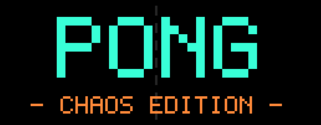

<p align="center">
  
</p>

# Pong: Chaos Edition

Pong, but things rarely stay normal for very long.

I made this because I wanted a more fun, unpredictable version of Pong that I could just launch and play offline. The basic game is still here: keep the ball away from your side, get it past the other paddle, and be the first to reach seven points. The difference is that the game keeps finding new ways to get in the way.

## What happens in a match?

You can play on your own against the CPU or play with someone else on the same keyboard. Before starting, choose the CPU difficulty and how chaotic you want the match to be.

During a match, random events can change the rules. You might suddenly have several balls to deal with, find the ball behaving strangely, dodge obstacles, or have your controls messed with. Some events are helpful; others are mostly there to make your life difficult. You can also press **E** to trigger an event yourself.

A few events take over the game completely and turn it into a different mini-game for a short while. These include things like a little platforming challenge, football, a tank battle, Snake, a timed chess match, a quiz, and even **PONGDOOM**. Do well in these challenges and you can earn points for the main match.

There are also fake ads, pop-ups, interruptions, and other deliberately annoying surprises. That's part of the joke: the game is supposed to get a bit ridiculous.

## Getting started

You need:

- **Python 3.8 or newer**
- **Pygame 2.x**

Install Pygame from the project folder:

```bash
python -m pip install -r requirements.txt
```

Then start the game:

```bash
python -m pong_chaos
```

That's it. The game runs locally and doesn't need an internet connection while you're playing. You may need an internet connection to install Pygame if you don't already have it.

## Controls

### In the menu

| Key | Action |
| --- | --- |
| `Up` / `Down` or `W` / `S` | Move through the menu |
| `Left` / `Right` or `A` / `D` | Change the selected option |
| `Enter` | Start the match or confirm |
| `Esc` | Quit |

### During Pong

| Key | Action |
| --- | --- |
| `W` / `S` | Move Player 1's paddle |
| `Up` / `Down` | Move Player 2's paddle |
| `Up` / `Down` | Also move Player 1 in one-player mode |
| `E` | Trigger a chaos event |
| `P` or `Esc` | Pause or resume |
| `Enter` | Return to the menu while paused, or start a rematch after a game |
| `M` | Toggle music |
| `N` | Toggle sound effects |
| `F11` | Toggle fullscreen |

Some events have their own controls. When that happens, the game tells you what to press on screen. So keep an eye on the instructions, especially when something unexpected takes over.

## A couple of things to know

- **1 Player:** play against the CPU. You can choose Easy, Normal, or Hard.
- **2 Players:** play locally with another person using the same keyboard.
- **Chaos:** choose Calm, Normal, or Insane before the match.
- **Match goal:** first to seven points wins, including points earned in takeover mini-games.

Have fun, and good luck keeping the match under control. You'll probably need it.
